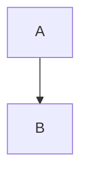

# Fórmulas LaTeX y diagramas Mermaid

> **Alcance**: qué sintaxis matemática y de diagramas reconoce el editor, con qué motores locales las
> dibuja, cómo se cachean y con qué límites, y qué sale en el HTML exportado.
>
> **Fuera de alcance**: el resaltado de los bloques de código normales (`MarkdownCodeHighlighter`), las
> tablas (`tablas-en-notas.md`), las imágenes (`imagenes-en-notas.md`) y las notas embebidas
> (`transclusion-de-notas.md`).
>
> **Fuente de verdad**: `services/LatexRenderService.cs`,
> `views/editor/Markdown/MarkdownSpecialBlocks.cs`,
> `views/editor/Markdown/MarkdownSpecialBlockFolding.cs`,
> `views/editor/Markdown/MarkdownFormulaCache.cs`, `views/editor/Markdown/MarkdownMermaidCache.cs`,
> `views/editor/Markdown/MarkdownLineParser.cs`,
> `views/editor/Markdown/MarkdownElementGenerator.cs`, `views/editor/EditorView.axaml(.cs)`,
> `assets/js/mermaid.min.js` y `services/NoteExportRenderer.cs`.

## 1. Qué se reconoce

````markdown
La energía es $E=mc^2$ y nada más.

$$
\int_0^1 x^2 \, dx
$$


````

- **Fórmula en línea**: `$…$` dentro de una línea.
- **Fórmula de bloque**: `$$…$$` en la misma línea, o un `$$` solo en su línea que abre y otro que cierra.
- **Diagrama**: una cerca de código cuyo lenguaje sea `mermaid`.

Lo que hay en una línea suelta lo reconoce `MarkdownLineParser.ScanMath`; lo que abarca varias líneas
—`$$` en líneas propias y las cercas `mermaid`— lo escanea `MarkdownSpecialBlocks.Scan` sobre el documento
entero, con el mismo *debounce* que las cercas de código, porque como ellas es una pregunta que no se puede
contestar mirando una línea aislada.

Reglas que evitan los falsos positivos, que en el caso del dólar son constantes:

- Un **dólar escapado** (`\$`) es literal.
- Los **delimitadores vacíos o con espacio pegado** (`$ x $`, `$$`) no son fórmula.
- Un dólar **rodeado de dígitos por ambos lados** no abre fórmula: `de $20 a $30` es dinero, no
  matemáticas.
- Dentro de una cerca de código no se reconoce nada: `$$` en un bloque de código es texto, que es justo
  como se documenta la sintaxis.
- Un bloque **sin cerrar** no existe todavía: mientras se escribe no se pliega ni se dibuja nada.

## 2. Con qué se dibuja

El requisito de partida es que **todo se renderice en local**: sin CDN, sin red y sin ejecutar nada que
venga de la nota. Son dos motores distintos porque el problema es distinto.

**Fórmulas — CSharpMath (`LatexRenderService`).** Compone los glifos en proceso con SkiaSharp y devuelve un
PNG transparente. No hay navegador, ni proceso externo, ni archivo temporal. Es una función pura y sin
estado: el llamador decide caché y tiempo límite, porque los dos dependen del ciclo de vida de la vista.
Tope defensivo de 8.192 caracteres por expresión.

**Diagramas — Mermaid (`MarkdownMermaidCache`).** Mermaid es JavaScript y no tiene equivalente en .NET, así
que se empaqueta el bundle (`assets/js/mermaid.min.js`, MIT, licencia junto al archivo) y lo ejecuta un
`NativeWebView` **oculto de 1×1 px**, uno por editor, que nunca navega fuera del documento que se le
inyecta ni recibe entrada. El documento anfitrión se arma una sola vez por proceso: el bundle pesa varios
megabytes y no depende de la nota. El WebView solo devuelve **SVG**, que se rasteriza con `Svg.Skia` antes
de entrar en el documento; el SVG que traiga `<script>` o `<foreignObject>` se descarta, y Mermaid se
inicializa con `securityLevel: 'strict'` y `htmlLabels: false`. Si el equipo no tiene motor de WebView
disponible, todos los diagramas degradan a bloque de código sin más.

Los colores de los diagramas se pasan por petición desde `MarkdownStyle`, así que un diagrama sigue al tema
activo en vez de traer el suyo.

## 3. Caché, límites y degradación

| | Fórmulas | Diagramas |
| --- | --- | --- |
| Capacidad | 96 entradas | 48 entradas |
| Clave | modo, tamaño de fuente, color y LaTeX | colores del tema y fuente del diagrama |
| Tiempo límite | 2 s | 4 s |
| Tope de entrada | 8 KB de LaTeX | 64 KB de fuente, 2 MB de SVG |

Las dos cachés son LRU acotadas: al desbordar, la entrada más vieja se descarta y su mapa de bits se
libera. El render es **asíncrono** en los dos casos —CSharpMath fuera del hilo de interfaz, Mermaid en el
WebView—, así que escribir nunca se queda esperando a un dibujo. Mientras llega se muestra «Renderizando…»
y, al terminar, la caché avisa con su evento `Changed` y el editor repinta.

**Degradar siempre es una opción válida.** Si el render falla o se pasa de tiempo, no se añade ninguna zona
al generador: queda visible el LaTeX original o el bloque de código Mermaid tal cual se escribió. Un
diagrama mal escrito enseña su código, que es lo que hay que arreglar, y nunca un hueco vacío. Es el mismo
criterio que ya seguía el resaltado de código.

## 4. Cómo se pliega

Un bloque de varias líneas se dibuja como un único elemento visual, así que las líneas que sobran se
retiran del layout con `MarkdownSpecialBlockFolding`: se pliega desde la segunda línea hasta el cierre y el
generador consume el bloque entero con un solo `InlineObjectElement`. El pliegue se rehace en cada cambio
de cursor, texto o estado de render, y se deshace entero al cambiar de documento (los pliegues viven en el
árbol de alturas del `TextView`, que se reconstruye al cambiar de documento).

Con el cursor dentro del bloque no se pliega nada: se ve y se edita el texto en crudo, como en tablas y
avisos.

Un diagrama empieza en una cerca ` ```mermaid `, y tanto el recuadro de los bloques de código
(`MarkdownBackgroundRenderer`) como su botón de copiar (`CodeBlockCopyOverlay`) reparsean el documento por
su cuenta; los dos preguntan por `LivePreviewState.IsRenderedSpecialBlockLine` para no pintarse encima del
diagrama ya dibujado.

## 5. En la exportación a HTML

`NoteExportRenderer` incrusta las **fórmulas** como PNG en `data:` URI, en negro sobre el fondo blanco de
la plantilla: en línea van dentro del párrafo, y las de bloque en un `<p class="math-block">` centrado. El
documento exportado sigue siendo un archivo autónomo, sin script ni CDN. Si el render falla, sale el LaTeX
original entre delimitadores dentro de un `<code class="math">`, que se lee igual de bien.

Los **diagramas Mermaid no se exportan como imagen**: necesitan el WebView del editor, que no existe en un
servicio de exportación. Salen como su bloque de código (`<pre><code class="language-mermaid">`), legible y
reutilizable en cualquier otra herramienta que sí sepa dibujarlo.

## 6. Cómo extender

- **Otro tipo de bloque enriquecido** se añade a `MarkdownSpecialBlockKind` y a
  `MarkdownSpecialBlocks.Scan`; el pliegue y el ciclo de render ya son genéricos. Hace falta una caché
  propia con su `Changed`, su capacidad y su tiempo límite, y su rama en `LivePreviewState.CanRender`.
- **Nada de contenido de terceros ejecutándose.** Lo que venga de una nota no se evalúa: Mermaid recibe la
  fuente como dato, devuelve SVG y ese SVG se filtra antes de dibujarse.
- Los textos de estado («Renderizando fórmula…», «Renderizando diagrama…») viven en los siete `.resx` de
  `localization/`, como el resto de la interfaz.
